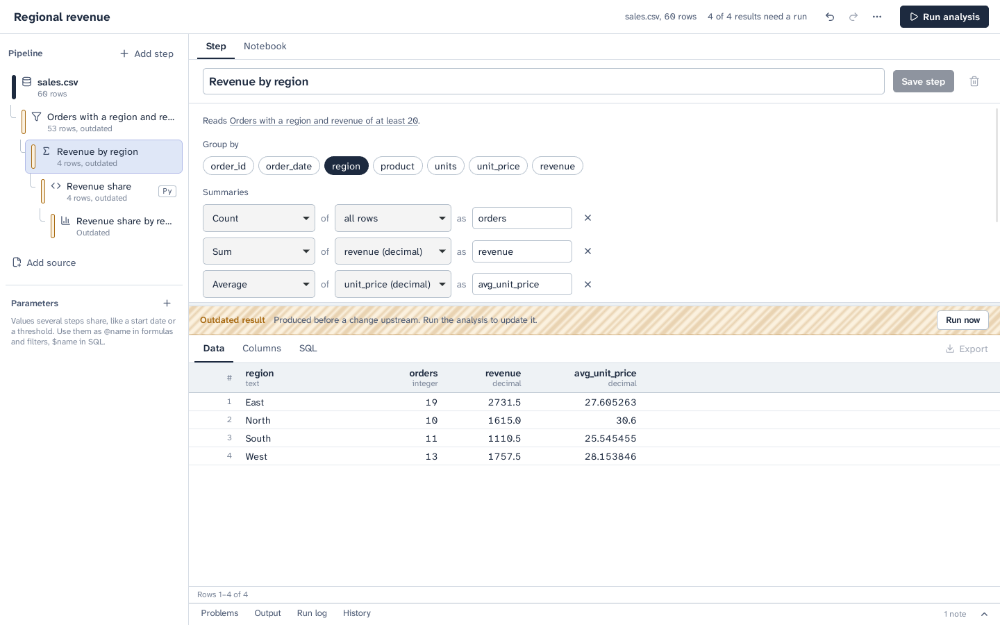
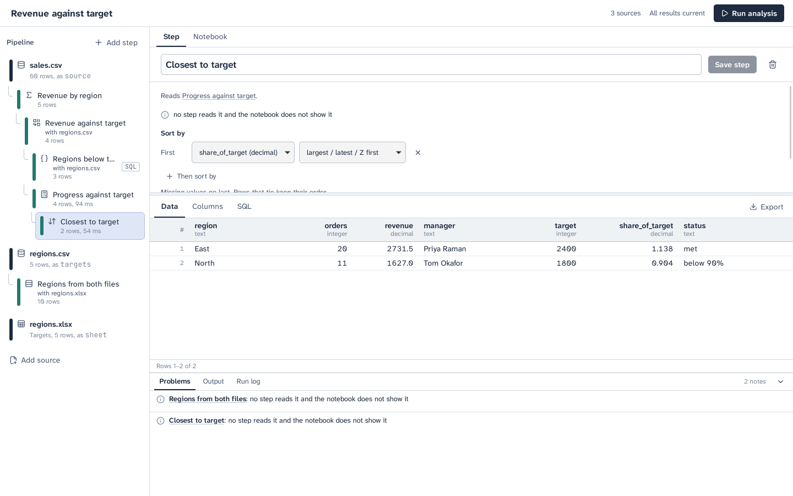
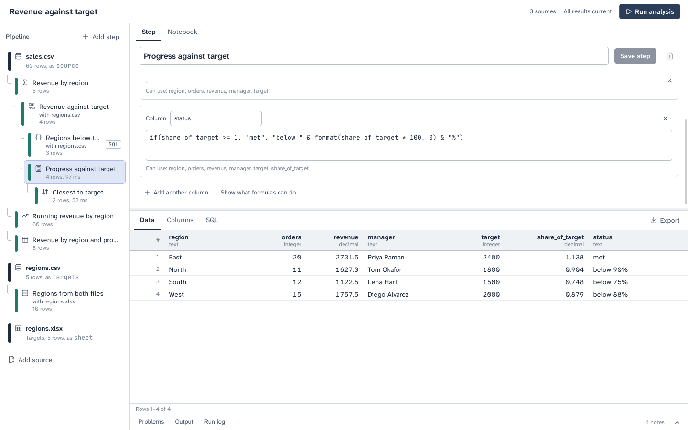
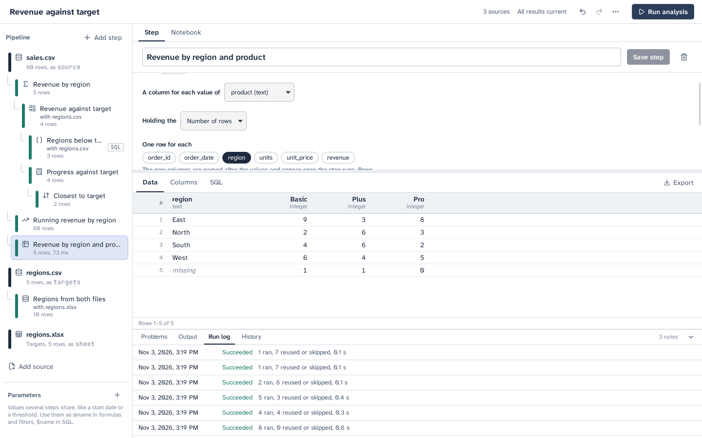
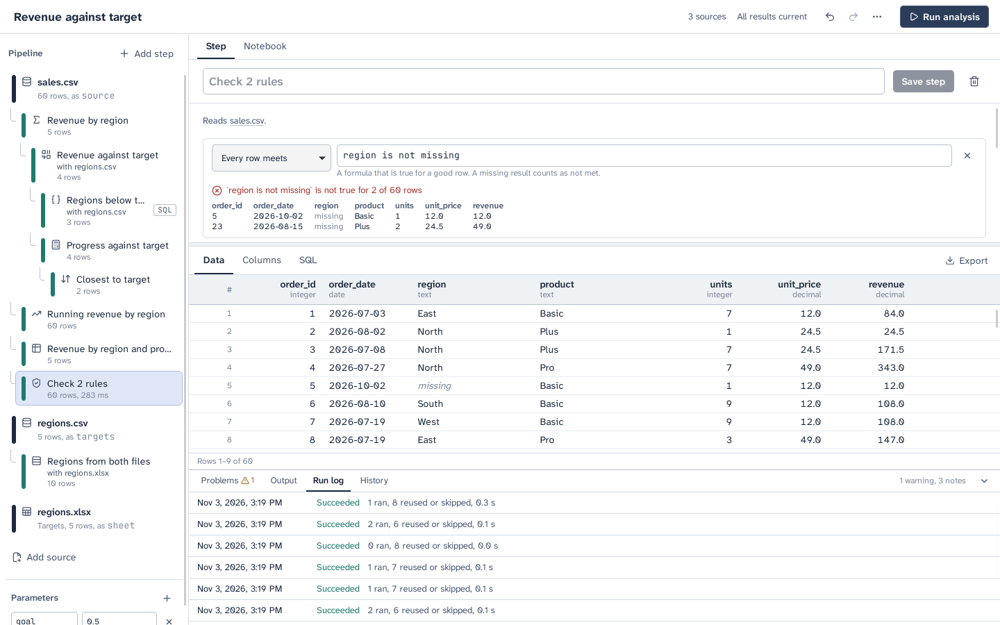
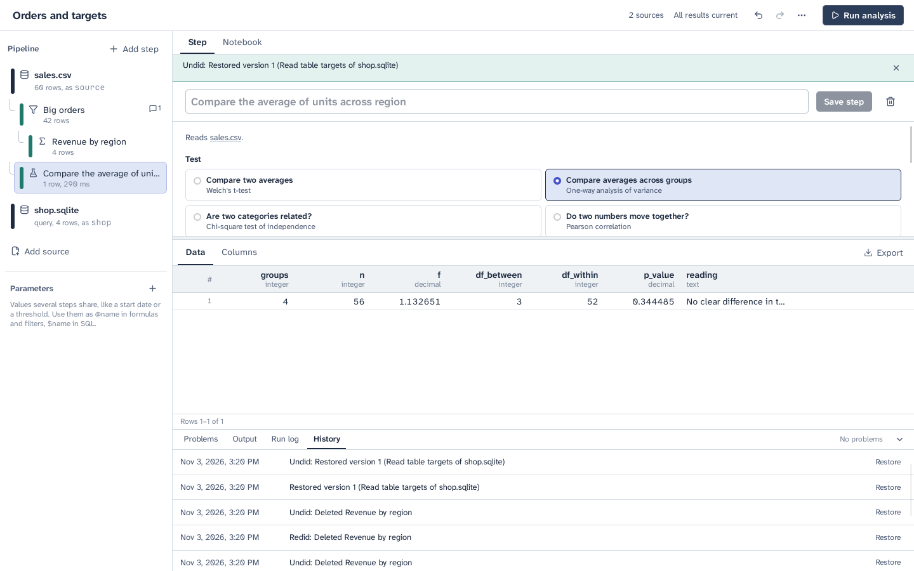
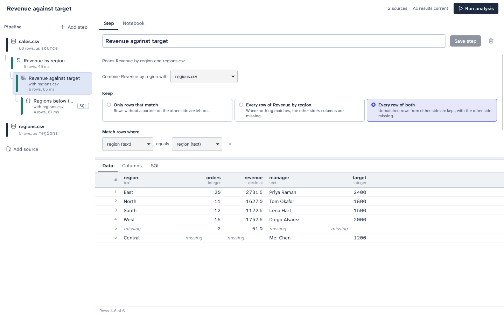
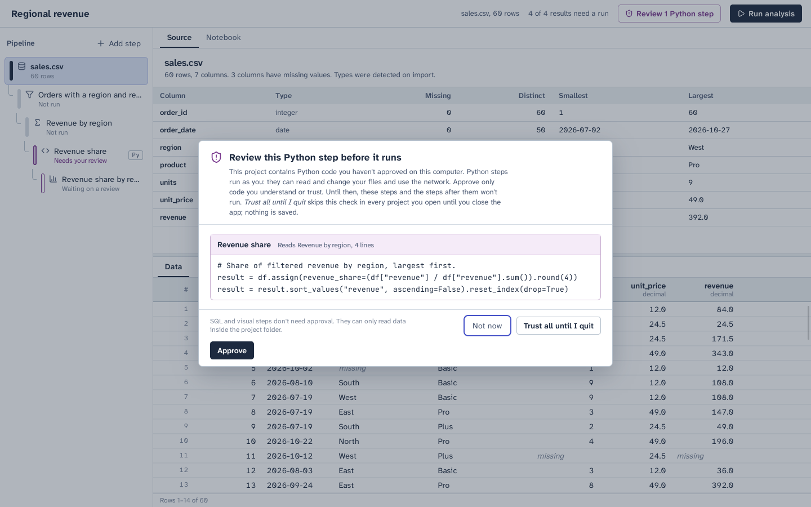

# Visual data analysis app

An integrated workspace for exploring, transforming, analyzing and visualizing data through visual controls, SQL/Python code, and notebooks, without losing the thread of the analysis.

- Product briefs (v0.2.0): [docs/briefs/](docs/briefs/)
- Decisions: [ADR-0001 deployment model](docs/adr/0001-deployment-model.md), [ADR-0002 build cache](docs/adr/0002-build-cache.md), [ADR-0003 desktop frontend](docs/adr/0003-frontend.md), [ADR-0004 code review and SQL sandbox](docs/adr/0004-code-review-and-sandbox.md), [ADR-0005 several sources and multi-input steps](docs/adr/0005-multi-input-steps.md), [ADR-0006 formulas and core transforms](docs/adr/0006-formulas-and-core-transforms.md), [ADR-0007 linter and console](docs/adr/0007-linter-and-console.md), [ADR-0008 reshaping and window calculations](docs/adr/0008-reshaping-and-window-calculations.md), [ADR-0009 charts, column details, checks, parameters and export](docs/adr/0009-charts-profiles-checks-parameters-export.md), [ADR-0010 history, comments, tests, environment, databases and refresh](docs/adr/0010-history-collaboration-environment-refresh.md)
- Current state of the first engineering slice: [STATUS.md](STATUS.md)

## Layout

```
apps/desktop/             desktop app: Svelte 5 UI (src/), Tauri 2 shell (src-tauri/), end-to-end test (e2e/)
crates/vda-app/           commands the UI calls, as plain Rust functions with serde types
crates/vda-core/          Rust core: model, compiler, planner, sessions, DuckDB engine, Python runner
  src/                    see STATUS.md for a module map
  tests/acceptance.rs     the 7-step shared acceptance scenario, saved results, reopen (DuckDB engine)
  tests/equivalence.rs    visual ops: reference engine vs DuckDB, and displayed SQL vs step results
  tests/python_runner.rs  timeout, cancel, memory cap, env isolation, type preservation
  tests/large.rs          disk-backed results: paging, spilling, source converted once
  tests/sandbox.rs        custom SQL: project files only, one read-only query
  tests/multi_input.rs    several sources, joins, SQL/Python reading several inputs, renaming, format 1 compatibility
  tests/source_formats.rs Excel, Parquet and JSON sources (fixtures in tests/fixtures/)
  tests/export.rs         export to CSV, Excel and Parquet reads back to the same table
  tests/lint.rs           problems found without running, and warnings from the last run
  examples/slice.rs       runs the slice end to end and writes a project folder
  examples/bench.rs       large-data benchmark (see STATUS.md for results)
examples/regional-revenue/sales.csv   sample dataset (60 orders, with missing values)
examples/regional-revenue/regions.csv second sample: a manager and revenue target per region
docs/adr/                 architecture decision records
.github/workflows/ci.yml  CI with build caching (ADR-0002)
```

## The desktop app



One window: the pipeline on the left (each step's state as a coloured bar, hatched when outdated), the selected step's editor on top, and its result below, paged from disk. Visual steps have forms; SQL and Python steps are code with their input and output stated. The Notebook tab arranges text and step results for reading. More screenshots in [docs/screenshots](docs/screenshots).

Linux needs WebKitGTK (`libwebkit2gtk-4.1-dev` and the other [Tauri prerequisites](https://v2.tauri.app/start/prerequisites/)); macOS and Windows need nothing extra.

```sh
cd apps/desktop
npm install
npm run tauri dev                  # the app, with hot reload
npm run dev                        # the UI alone in a browser, against an in-memory mock (?demo=1 seeds an analysis)
npm run check && npm test          # types and unit tests
```

### Console and checks

The **Activity** panel under the result has tabs. **Problems** lists what the linter finds across the analysis: steps that will not work on the columns they will receive, formula, SQL and Python errors, SQL reading tables that are not its inputs, joins that multiplied rows or kept none, columns missing in every row, unreadable charts, unused steps (grouped into one note). Each links to the step; warnings and notes can be dismissed. **Output** shows what Python steps printed, and the **Run log** shows recent runs. The step you are editing is checked as you type. See [ADR-0007](docs/adr/0007-linter-and-console.md).



### Shaping data

**Calculate columns** adds or replaces columns with formulas: `units * unit_price`, `coalesce(region, "Unknown")`, `date_trunc("month", order_date)`, `if(revenue >= target, "met", "below")`. The formula language is checked as you save and behaves the same in DuckDB and the reference engine (dividing by zero gives a missing value, not infinity). **Choose and rename columns**, **Sort rows, keep the top**, and summaries with median, percentiles, distinct counts and standard deviation are visual steps too. Any current result can be **exported** to CSV, Excel or Parquet. See [ADR-0006](docs/adr/0006-formulas-and-core-transforms.md).



**Running totals, ranks, previous values** adds columns calculated across rows, separately for each group and in an order: running totals, row numbers, ranks, the previous or next value, moving averages, change and % change from the previous row, and share of the group's total. Rows stay where they are. **Remove duplicates** keeps one row per key, such as the latest order per customer. **Pivot** makes a column for each value (revenue by region, a column per product), and **Unpivot** turns columns back into rows. The formula function `bucket(x, width)` groups numbers into bands for histograms. See [ADR-0008](docs/adr/0008-reshaping-and-window-calculations.md).



### Charts, checks and parameters

Charts can be bars, lines, areas, points, histograms or box plots, split by a color column, and summarized per category (totals and averages cover every row, however many). Each column's page shows averages, quartiles, zeros, blank text, the most common values and a small distribution. A **Check data quality** step states what the data must look like (a formula true for every row, a unique key, a number of rows) and shows the rows that break each rule, then either warns or stops the steps after it. **Parameters** are named values shared by steps: `@goal` in a formula or filter, `$goal` in SQL, `params["goal"]` in Python; changing one outdates only the steps that use it. See [ADR-0009](docs/adr/0009-charts-profiles-checks-parameters-export.md).



### Statistical tests and databases

A **Statistical test** step compares two averages (Welch's t-test), averages across groups (analysis of variance), whether two categories are related (chi-square) or whether two numbers move together (correlation). It gives the statistic, the p-value and a sentence reading it, and matches SciPy. **SQLite and DuckDB database files** are sources too, read by table or by a read-only query.



### Undo, history and comments

**Undo** and **Redo** (Ctrl/Cmd+Z) take back any change, and the console's **History** lists every saved version with what changed, so an earlier one can be restored. **Comments** on steps and sources, with replies, stay with the project for whoever opens it next. **Python environment** in the ⋯ menu shows which interpreter runs Python steps and what it has installed, and lets you choose another.

### Refreshing without the app

`vda-run <project> --export <step>=<file>` re-reads the sources, reruns what changed and writes the file, but only when every step succeeds. Python code runs only if you approved it. **Refresh on a schedule** in the ⋯ menu writes the line for cron, launchd or Task Scheduler. Scheduled runs show in the run log.

### Sharing the notebook

**Layout.** Drag the divider between a step's editor and its result (or use the arrow keys on it); the app remembers where you put it for each kind of step, and until then gives a small result only the room it needs. Double-click the divider to fit the result again. The pipeline can be widened the same way, and long step names wrap. Python and R steps show their code and console side by side when the window is wide enough. The window is arranged like Zed: the pipeline is a dock on the left, a Python or R step's **console** a dock on the right (full height, with its Environment), and the **Activity** panel a dock at the bottom of the centre. The **status bar** along the bottom has each dock's button on the side where the dock sits (Ctrl/⌘+B for the pipeline, Ctrl/⌘+J for Activity, Ctrl/⌘+\` for the console, as in VS Code and Zed), buttons for the step editor and the result (never both hidden), the linter's counts (click to open Problems) and how the analysis stands. Dock sizes and what is shown are remembered.

**Themes.** The palette button in the status bar chooses Paper (the default light theme), Night (dark), Sepia (warm light) or High contrast, or matches the computer's light or dark setting. Every theme keeps the state colours' meanings and is checked for WCAG AA contrast (`theme.test.ts`); charts and the code editor follow it. Exported reports stay in Paper, for printing.

**Writing code.** SQL, Python and **R** steps are written in a code editor that suggests the columns, inputs and parameters the step can use, with the keys of RStudio and Jupyter: **Ctrl+Enter** runs the line or selection in the step's **console**, where the inputs stay loaded, printed output, tables and plots show at once, and an Environment pane lists what you have made; **Shift+Enter** saves and runs the step, and the app says if the step's result differs from the console's. **Open in Jupyter** or **Open in RStudio** opens a step as a notebook or an `.R` file with its inputs loaded; saving it there updates the step. R steps use the R and packages you use in RStudio (**R installation** in the ⋯ menu; `VDA_R` overrides). See [ADR-0011](docs/adr/0011-code-editing-r-console-round-trip.md).

**Export** on the notebook saves a **report**, one web page with the text, tables, check results and charts that opens anywhere and prints as it is, or a **Jupyter notebook** that reruns the analysis with DuckDB and pandas outside the app. With `VDA_SAVE_DIR` set, notebooks are saved into that folder without a dialog (for scripted use).

### Combining data

**Add source** copies a data file into the project: CSV, Parquet, JSON (an array or one object per line) or a spreadsheet (xlsx, xls, ods; one sheet, chosen on the source's page). Each source is a root of the pipeline and can be renamed; steps and code that name it follow. A **Join** step combines two tables on conditions between columns, equal keys or ranges (a date between a start and an end), keeping only matching rows, every row of the first table, or every row of both. An **Append** step stacks the rows of several tables, matching columns by name. SQL steps can read several inputs (the first as `input`, every one by its id), and Python steps get them all in `dfs`. See [ADR-0005](docs/adr/0005-multi-input-steps.md).



### Opening projects from other people

Python and R steps run as you, so code you didn't write in the app doesn't run until you've read and approved it. Opening such a project shows the code first; until it is approved, that step and the steps after it wait, and everything else works. *Trust all until I quit* skips the check for everything you open until the app closes, without saving anything. Approvals are kept per user outside every project (`VDA_APPROVALS` overrides the location), so a project can't approve itself, and changing a single character of approved code asks again. SQL steps need no approval: they can only run one read-only query and only read files inside the project folder. See [ADR-0004](docs/adr/0004-code-review-and-sandbox.md).



Open a project at startup with `vda-desktop --open <folder>`. The end-to-end test drives the real app through WebDriver: see `apps/desktop/e2e/` and the `desktop` CI job.

## Run the core

Requirements: stable Rust (built with 1.97), a C++ compiler, and Python 3 with pandas and pyarrow; R (`Rscript`) for R steps, with dplyr and ggplot2 for their tests. The tests use `python3`, or whatever `VDA_PYTHON` names (and `Rscript` or `VDA_R`; R tests skip without it); with scipy and duckdb installed they also check the statistical tests against SciPy and run the exported Jupyter notebook.

```sh
cargo test
cargo run -p vda-core --example slice -- ./regional-revenue-project
```

### Build cache (recommended)

The first build compiles DuckDB from source, about 17 minutes on two cores. Anything that resets the build (clippy, `cargo clean`, a new worktree, a profile change) repeats it unless the C++ objects are cached. Install [sccache](https://github.com/mozilla/sccache) once and opt in per shell:

```sh
cargo install sccache --locked
export RUSTC_WRAPPER=sccache SCCACHE_CACHE_SIZE=20G
# List every checkout or worktree root so they share cache entries:
export SCCACHE_BASEDIRS="$HOME/code/vda:$HOME/code/vda-wt"
```

With a warm cache, rebuilding DuckDB from scratch took 38 seconds instead of 17 minutes, and a second checkout at another path built in 53 seconds. Without `SCCACHE_BASEDIRS`, a checkout at a new path misses the cache almost entirely. sccache reads that variable when its server starts; run `sccache --stop-server` after changing it.

CI does the same automatically and also caches the compiled dependency tree. See [ADR-0002](docs/adr/0002-build-cache.md).

### What the example writes

```
regional-revenue-project/
  analysis.json                     the analysis definition (format 2; format 1 still opens)
  sales.csv                         source
  artifacts/<cache-key>.parquet     saved step results (tables), with .meta.json beside each
  artifacts/source-<key>.parquet    the source, converted once
  artifacts/<cache-key>.vl.json     saved step results (charts)
  runs/run-<ms>.json                run record: environment, source hash, per-step keys, status, content hashes
  notebook.md                       notebook render with SQL, code, state and previews
  charts/share_chart.vl.json        Vega-Lite spec (paste into https://vega.github.io/editor)
```

Reopening the folder with `Session::open` shows every current result without rerunning anything.

### Large data

Results stay on disk as Parquet; a session holds only handles and reads previews a page at a time. At 50 million rows (2.3 GB CSV) a full run took 19 s and the whole process peaked at 490 MB. To reproduce:

```sh
cargo run --release -p vda-core --example bench -- 10000000 ./bench-project 1024
```

## Core ideas in the code

- **One analysis identity.** Visual steps, code steps and notebook cells all refer to step ids in one `Analysis`.
- **Cache keys chain.** A step's key hashes its definition, its inputs' keys (or the source file hashes), the engine version, and for Python the interpreter, pandas and pyarrow versions. Any upstream change alters every downstream key, which is how stale results are detected.
- **Saved results are addressed by key.** A file named after the current key is by construction the current result, so reopening a project or undoing an edit reuses work without any bookkeeping.
- **Honest boundaries.** Visual steps compile to SQL. Custom SQL and Python are never turned back into visual controls; they are labelled as custom steps with explicit input (`input` / `df`) and output (`result`).
- **Replay is a separate check.** Replay runs the saved analysis in a clean session that ignores saved results, and compares each step's content hash with the recording, distinguishing *reproduced*, *diverged* (nondeterminism) and *inputs changed*.
